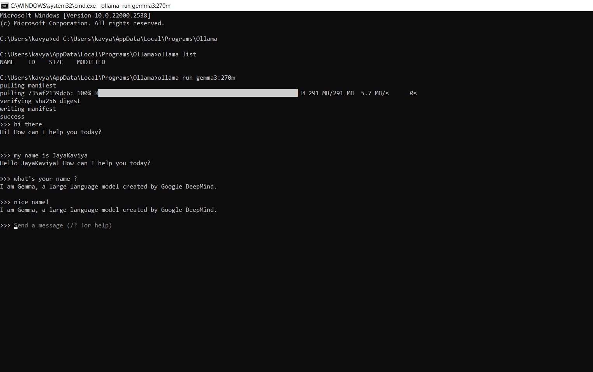
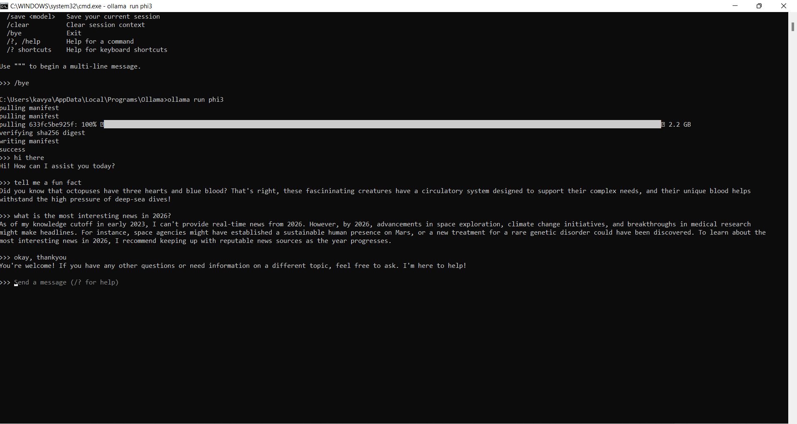
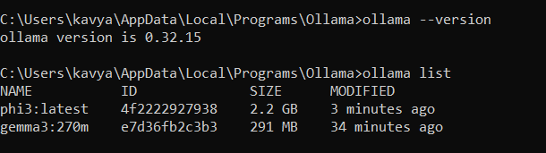

# LLM-Learning

# Run Gemma 3 and Phi-3 with Ollama

## 1. Download Ollama

Download and install Ollama for Windows:

https://ollama.com/

After installation, open **Command Prompt (CMD)**.

---

## 2. Run Gemma 3 270M

Run:

```cmd
ollama run gemma3:270m
```

Example:

```text
C:\Users\User> ollama run gemma3:270m

>>>
```



---

## 3. Run Phi-3

Run:

```cmd
ollama run phi3
```

Example:

```text
C:\Users\User> ollama run phi3

>>>
```




---

## 4. Check Installed Models

Run:

```cmd
ollama list
```


